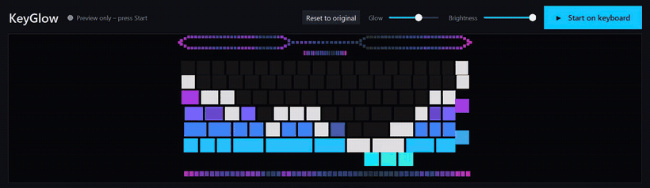
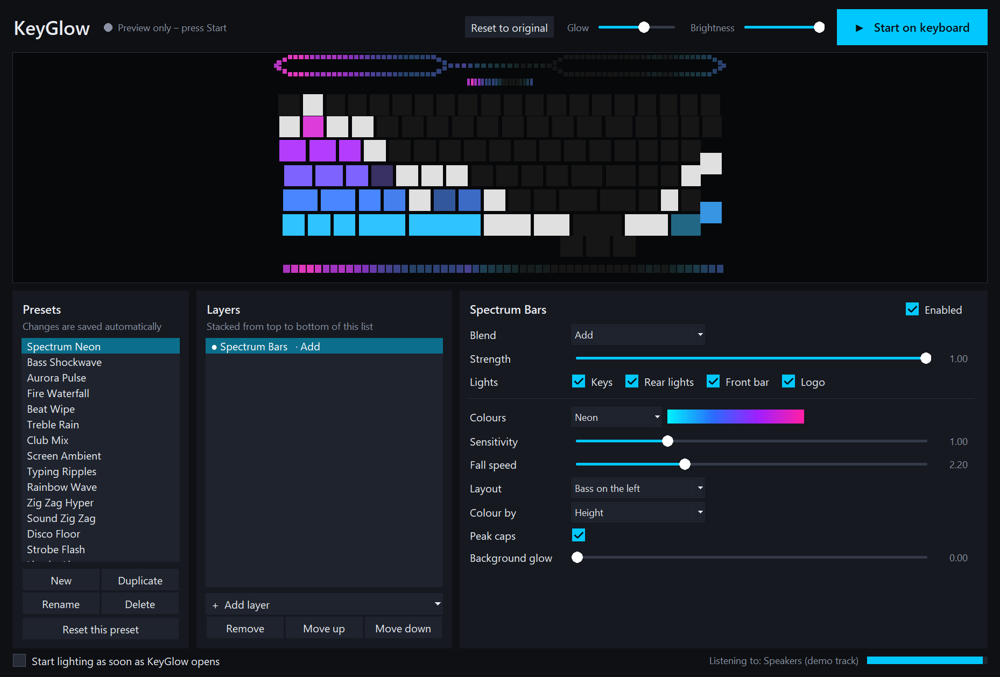
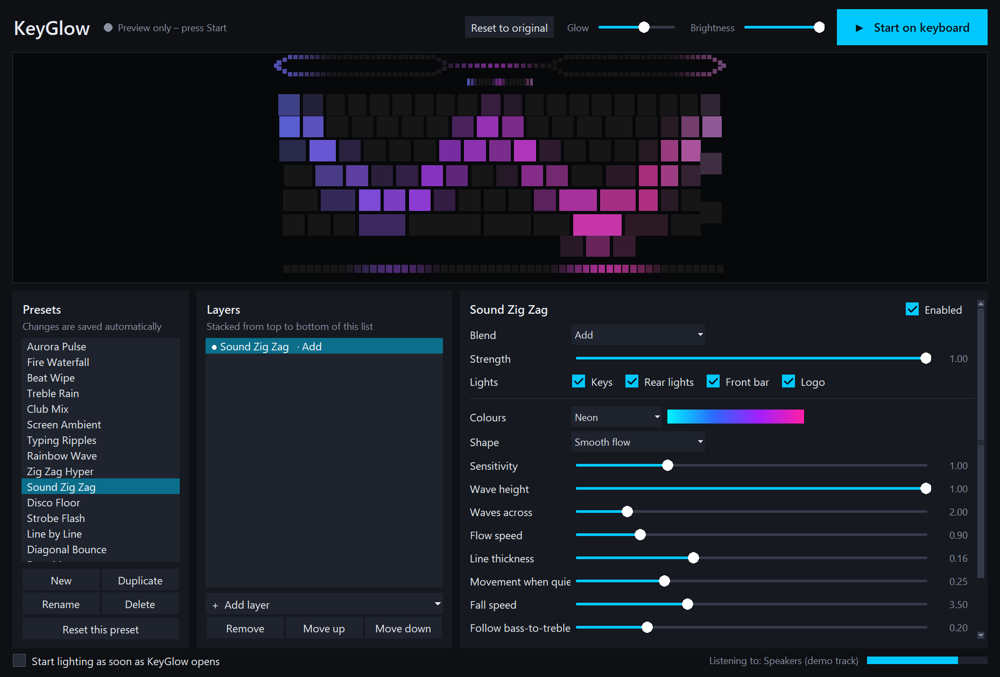
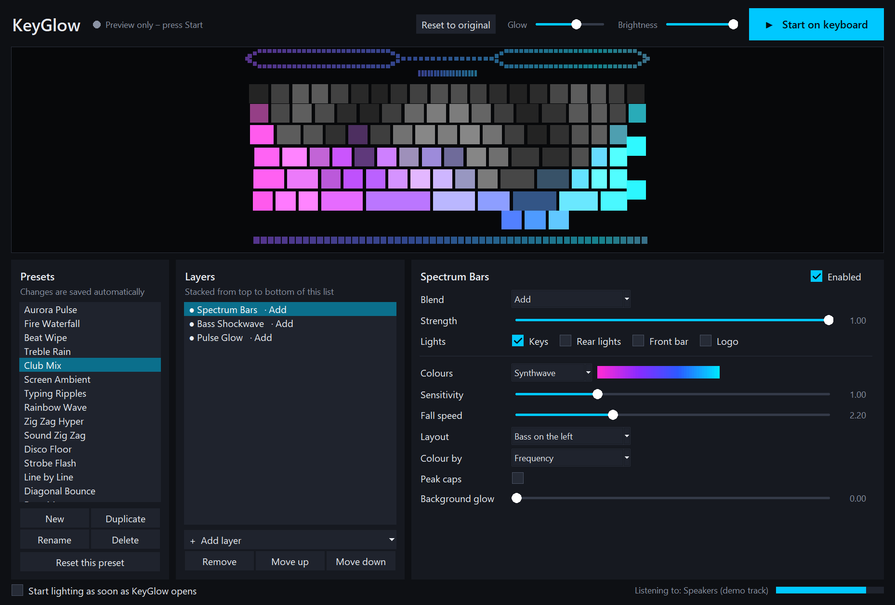
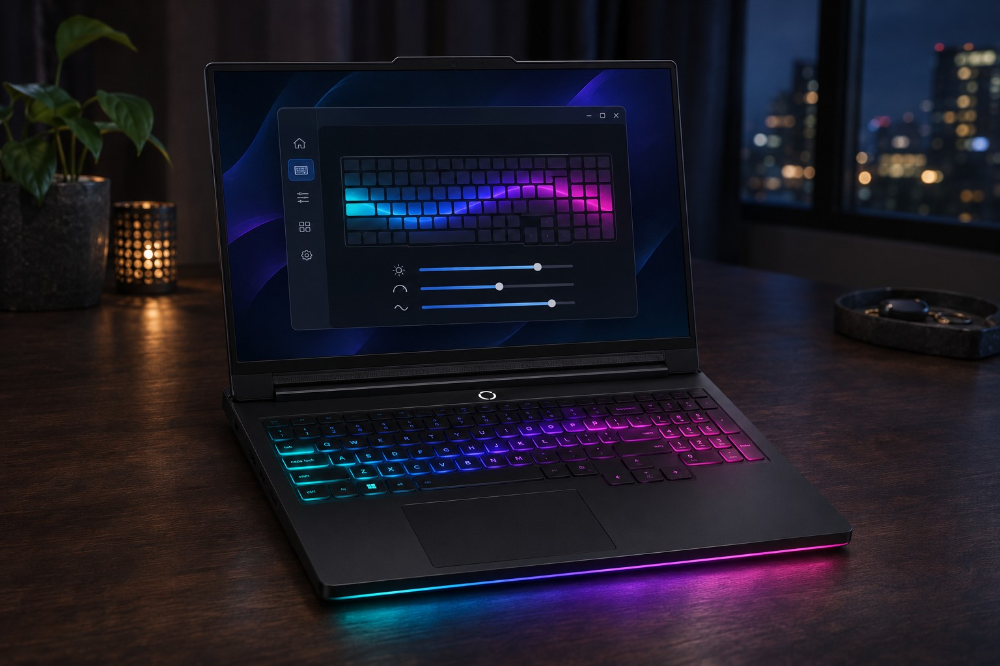

# KeyGlow

Music- and screen-reactive lighting for the per-key RGB keyboard on Lenovo Legion laptops.
It drives the keys, the rear lights, the front light bar and the logo, and it runs alongside Legion Space instead of replacing it.



*Recording of the app's own preview while a demo track plays. Full 47-second clip with sound: [docs/keyglow-demo.mp4](docs/keyglow-demo.mp4).*

## Why

Legion Space only ships a couple of audio effects for the per-key keyboard, and you cannot build your own.
KeyGlow adds 18 effects you can stack, recolour and tune, with 21 ready-made presets.

## Tested on

| | |
|---|---|
| Laptop | Lenovo Legion Pro 7i Gen 10 (16IAX10H, machine type 83F5) |
| OS | Windows 11 (build 26200) |
| Legion Space | 2.1.11.31, left installed and running |
| Keyboard controller | ITE `048D:C197` (vendor channel) and `048D:C193` (HID LampArray), 318 lights |

**This is the only machine it has been tested on.** Other Legion models with the same per-key keyboard may work; if the keyboard is not found, the app shows a message and does nothing.

## Download and run

1. Get `KeyGlow.exe` from the [latest release](../../releases/latest). There is no installer.
2. Run it. Windows SmartScreen will warn because the file is not code-signed: choose **More info > Run anyway**, or build it yourself from source (below).
3. Pick a preset on the left. The picture of the keyboard at the top shows what it will look like.
4. Press **Start on keyboard**. Play some music.
5. Press **Stop - give lights back** (or just close the app) and the keyboard returns to its normal Legion Space profile.

Turn **Windows Dynamic Lighting** off (Settings > Personalization > Dynamic Lighting) while you use KeyGlow, otherwise Windows drives the same lights and the two flicker against each other. KeyGlow warns you if it is on.



## What is in it

**Reacts to music** (whatever the PC is playing, no microphone)

| Effect | What it does |
|---|---|
| Spectrum Bars | Classic equaliser bars, bass to treble across the keyboard |
| Bass Shockwave | A ring bursts out on every beat |
| Pulse Glow | The whole keyboard breathes with the bass, mids or treble |
| Waterfall | The spectrum scrolls down (or up, or sideways) over time |
| Beat Wipe | A new colour wipes across on every beat |
| Treble Rain | Drops fall faster the busier the high notes are |
| Zig Zag | A sharp zigzag that flips direction and colour on each beat |
| Sound Zig Zag | One smooth wave through the middle that grows with the volume |
| Disco Tiles | Coloured tiles that re-roll on the beat |
| Strobe Flash | Full-keyboard flashes on the beat |
| Line by Line | One row (or column) at a time |
| Diagonal Bounce | Stripes sweep one diagonal, then the other |
| Screen + Sound | Your screen's colours, pulsing with the music |

**Ambient**

| Effect | What it does |
|---|---|
| Screen Mirror | Copies the colours of your main screen onto the keyboard |
| Plasma | Slow moving colour clouds |
| Gradient / Wave | A scrolling gradient in any direction |
| Solid Colour | One colour, optionally pulsing with the bass |
| Typing Ripples | Rings spread from the keys you press |

Strobe Flash, Disco Tiles and the "Rave Max" preset flash quickly. Avoid them if you are sensitive to flashing lights.



## Make your own preset

1. Under **Presets**, press **New** (or **Duplicate** to start from an existing one), then **Rename**.
2. Under **Layers**, press **+ Add layer** and pick an effect. Add more layers to stack effects; they are mixed from the top of the list to the bottom.
3. Select a layer to see its settings on the right:
   - **Blend** - how it mixes with the layers above it (Add, Lighten, Replace, Multiply, Screen).
   - **Strength** - how strongly it shows.
   - **Lights** - which parts it covers: Keys, Rear lights, Front bar, Logo. Example: spectrum bars on the keys and a pulse on the edge lights.
   - **Colours** - 13 built-in palettes, or choose **Custom...** and pick up to 6 colours of your own.
   - Sliders for sensitivity, speed, size and so on, different for each effect.
4. Everything saves by itself. **Reset this preset** restores a built-in preset; **Reset to original** (top bar) restores all built-in presets and keeps the ones you made.

The top bar has two global controls: **Brightness**, and **Glow**, which lifts the dimmer parts of every effect so the whole keyboard looks brighter.



## Good to know

- **It only borrows the lights.** Nothing is written to the keyboard's memory and no Legion Space profile is edited. If KeyGlow is closed, crashes or is killed, a small helper process hands the lights back.
- **About 12 updates a second.** That is as fast as this keyboard's firmware shows frames on this route, so very fast motion looks stepped.
- **Settings** are stored in `%APPDATA%\KeyGlow\config.json`.
- **Typing Ripples** reads which keys are down only to draw the ripple. Nothing is stored or sent anywhere.
- **No network access.** The app does not connect to the internet.
- Not tested: sleep/wake and pressing Fn+Space while it runs. KeyGlow re-takes control every 2 seconds, which should cover both.

## How it works

The keyboard exposes a standard HID LampArray interface, but its firmware ignores colours sent there until it is told that the PC is in charge. Lenovo's own software does that with one vendor HID feature report; KeyGlow sends the same report on Start and the opposite one on Stop. Details, including how to read back what the keyboard is really showing, are in [docs/HOW-IT-WORKS.md](docs/HOW-IT-WORKS.md).

## Build from source

Needs Windows and Python 3.12 or newer (the release is built with 3.14).

```
pip install -r requirements.txt
python src\main.py            :: run from source
build\build.bat               :: build KeyGlow.exe into the repo folder
```

## Disclaimer

KeyGlow is an unofficial hobby project. It is not made, endorsed or supported by Lenovo. "Lenovo", "Legion" and "Legion Space" are trademarks of Lenovo. It talks to your keyboard controller directly; it has worked without problems on the one laptop above, but you use it at your own risk.

The image below is an AI-generated illustration, not a photo of the real laptop.



## Licence

MIT, see [LICENSE](LICENSE).
